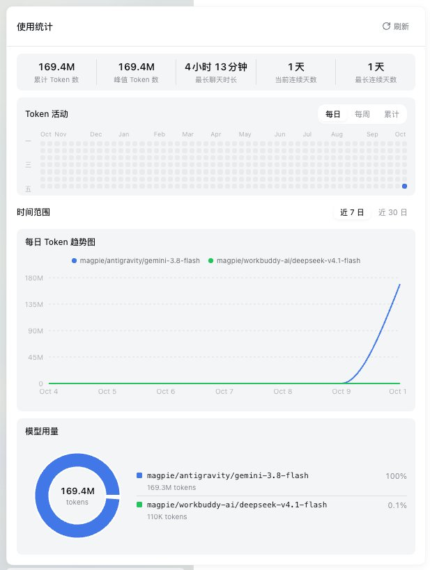

# dsh-scope

[](https://www.dsh.so/artifact/dsh-scope/)
[](LICENSE)

**English** · [简体中文](README.zh.md)

**Usage statistics for [DeepSeek Harness](https://github.com/deepseek-ai/deepseek-harness) (`dsh`)** — a lifetime dashboard of your token usage across every session, plus a Codex-style `/context` lens for the session you are in.

DeepSeek Harness computes rich token accounting and then shows you none of it. `dsh-scope` surfaces it in two places:

## Usage statistics (sidebar footer)

The headline feature, ported from [ZCode](https://github.com/zai-org/ZCode)'s 「应用用量」. Open it from the sidebar foot — a label when the sidebar is wide, an icon on the rail.



- **Lifetime summary strip** — cumulative and peak-day tokens, longest session, current and longest streaks.
- **Token activity** — a 52-week heatmap with **daily / weekly / cumulative** modes. Daily colors each day on its own usage; weekly sums each column; cumulative runs a running total across columns, so the same grid reads either as a year at a glance or as growth over time.
- **Time range** — last 7 days or last 30 days, driving both views below.
- **Daily token trend** — one line per model with a wrapping legend and a per-day tooltip. Only models used inside the window appear as series.
- **Model usage** — a donut with the window total in the center and a percentage list beside it.

The whole panel is one request to this plugin's own loopback-only endpoint.

## Context Lens (session header)

A Codex-style `/context` readout for the session in front of you: a live occupancy ring in the header that opens into window occupancy, a segmented system / tools / messages composition bar, per-bucket session totals, and KV-cache hit rate. It reads the official `token-meter` session projections through `useProjection` — no RPC, no custom wire protocol.

## Why

The harness already does the hard part: `token-meter` folds usage out of the durable session log, and the slot registry gives plugins somewhere to mount. What was missing was a surface. `dsh-scope` fills it the harness-native way — reading projections the platform already computes, styling with the platform's design tokens (`--dsw-alias-*`), and mounting through the platform's slot registry. Light and dark themes are both correct with zero media queries.

## Install

Requires `dsh` ≥ `0.1.0-rc.6` on your PATH.

```sh
dsh plugin --profile <profile> add dsh-scope
dsh web                             # restart dsh to load the plugin
```

`<profile>` is the directory under `~/.dsh/profiles/` that your dsh runs from — the Desktop app uses `desktop`.

<details>
<summary>Install from source</summary>

```sh
git clone https://github.com/helloxkk/dsh-scope.git
cd dsh-scope
npm install && npm run build
node scripts/install.mjs <profile>   # e.g. desktop, headless, rescue
dsh web                              # restart dsh to load the plugin
```

The script refuses an unknown profile rather than guessing.

</details>

The installer copies `lib/`, `cordis.patch.yml`, and `package.json` into the profile's `node_modules` and appends the bundle insert to the profile's `cordis.patch.yml` (idempotent — safe to re-run after every rebuild).

### Uninstall

```sh
rm -rf ~/.dsh/profiles/<profile>/node_modules/dsh-scope
# then remove the "# dsh-scope" block from ~/.dsh/profiles/<profile>/cordis.patch.yml
rm -f ~/.dsh/storages/dsh-scope-cache.json   # optional: drop the fold cache
```

## How it works

**Host half** (`lib/index.js`): one read-only, loopback-fenced endpoint, `GET /api/dsh-scope/days`. Aggregation is incremental — per-session fold state is cached in memory and persisted to `~/.dsh/storages/dsh-scope-cache.json`, and each request folds only the events added since the last fold. Live sessions fold their in-memory tail; persisted sessions skip work entirely while the backend's opaque revision is unchanged, and otherwise read only the new suffix, with contiguity checks and a full refold when a log was truncated or rewritten. Steady-state cost stays O(new events) no matter how large the logs grow.

Fold semantics mirror `dsh-token-meter`'s `tokenUsage` projection: a usage sample rides an `assistant/chunk` (`data.chunk.type === "usage"`) or an `assistant/message` (`data.usage`). A repeated sample for the same (turn, step) **replaces** the earlier value rather than double counting, re-attributed to the later event's day and model. Model attribution follows `assistant/message`'s `data.message.source`, falling back to the last `request/header` config.

Beyond token buckets, the fold counts `turn/start` and `tool/call` events per day (feeding the weekly/cumulative heatmap tooltips) and tracks each session's first and last event timestamps so the summary strip can report the longest session. The payload carries **every** model per day rather than a truncated top-N, so the trend chart and donut always cover all of them.

**Client half** (`lib/client.js`, loaded via the package's `dsh.client` declaration):

- `sidebar.footer.action` renders the usage trigger. The panel fetches `/api/dsh-scope/days` same-origin and derives every view from that single payload.
- `conversation.session.header.actions` (order 30, after the job list) renders the lens trigger. Its popover reads three official projections — `tokenUsage` (four buckets accumulated over the whole durable log), `contextPressure` (input-side window pressure plus the route's context window), and `contextBreakdown` (heuristic system/tools/message composition of the next request).

Nothing is sent anywhere: the endpoint refuses non-loopback callers and non-GET methods before doing any work, and no provider credentials are read.

## Development

```sh
npm install
npm run build                          # tsdown: host ESM + browser ModuleLoader bundle
node scripts/fixture-session.mjs       # optional: write a demo session log with usage events
node scripts/install.mjs <profile>     # then restart dsh
```

`npm run build` emits two artifacts:

- `lib/index.js` — the Node host half. `@deepseek-ai/*` stays external and resolves against the profile's own installation at runtime.
- `lib/client.js` — the browser half, wrapped in the harness ModuleLoader factory format. Platform modules (`react`, `@deepseek-ai/dsh-client-*`) stay external and resolve through the loader's injected `require`; everything else, including Recharts, is inlined.

Because the harness caches plugin modules at startup, **only the client half hot-reloads**. After changing anything under `src/index.js` or `src/usage.js`, restart dsh.

## Compatibility

Built and verified against `dsh` `0.1.0-rc.6` and `0.2.0-rc.2` (`@deepseek-ai/dsh-base` / `dsh-web-app` bundles). The harness is in developer preview and iterates quickly — expect compatibility-breaking changes.

The host half reads persisted logs through whichever API the installed `sessionPersistence` exposes: `open(id, 'read')` plus `handle.read(offset)` on `0.2.x`, and the older `readFrom(id, fromSeq)` elsewhere. `list()` is normalized to `{ header, revision }` snapshots, so both shapes fold identically.

dsh imports each plugin module once at startup, so a profile config reload cannot replace host-half code: **restart dsh after rebuilding**.

## Credits

The usage-statistics panel is a port of ZCode's 「应用用量」 surface
([zai-org/ZCode](https://github.com/zai-org/ZCode), Apache-2.0). Layout, the
heatmap's modes and month-ruler alignment, and the shared number/date
formatting follow upstream; the Tailwind classes, types, i18n layer, and chart
palette are replaced with this plugin's own CSS, plain JavaScript and the DSH
theme aliases. Charts render with [Recharts](https://github.com/recharts/recharts) (MIT).
See [NOTICE.md](NOTICE.md) for details.

## License

MIT
